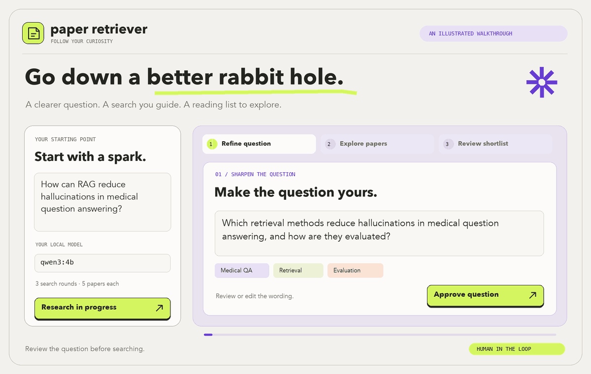

# Paper Retriever
A simple Agentic Framework for retrieving arXiv paper relevant to a query, which can be improved via LLM.

A small local workspace for finding research papers. Start with a question, let a local model help you sharpen it, then explore arXiv together. You can edit the question and approve each search along the way.

<picture>
  <source media="(prefers-reduced-motion: reduce)" srcset="docs/images/walkthrough.png">
  
</picture>

*An illustrated walkthrough of the workspace. [View the still image](docs/images/walkthrough.png).*

The idea is to make the first part of a literature search a little easier, while keeping a record of how you found each paper.

Built with Python, LangGraph, and Ollama. This is an early version: query improvement, paper search, and shortlisting work today. Reading full papers and answering questions with citations come later.

## Getting started

You'll need Python 3.11 or newer, [Ollama](https://ollama.com/), and an internet connection for arXiv searches. The examples below use `qwen3:4b`.

```bash
git clone https://github.com/LorenzoVenturi/agentic-paper-retrieval.git
cd agentic-paper-retrieval
python3 -m venv .venv
source .venv/bin/activate
python -m pip install -e .
```

Start Ollama in a separate terminal and leave it running:

```bash
ollama serve
```

If the Ollama app is already running its server, you can skip that step. Back in the project terminal, download the model and start the website:

```bash
ollama pull qwen3:4b
ollama pull embeddinggemma
paper-retriever ui
```

Open [localhost:8000](http://127.0.0.1:8000). If the port is busy, use `paper-retriever ui --port 8001`.

## Using the workspace

Try a question like:

> How can RAG reduce hallucinations in medical question answering?

1. Enter your question and click **Improve my question**.
2. Read the suggested wording, concepts, and search directions. Edit anything that needs more context.
3. Approve the search keywords, or change them before they go to arXiv.
4. Browse the papers and abstracts. Each approved round searches arXiv and your saved library in parallel. The model may suggest another search before putting together a shortlist.
5. When research finishes, choose papers in **Save papers for future research?**, then click **Save selected** or **Skip saving**. The shortlist is preselected; you can choose other retrieved papers too.

Editing the research question creates a fresh search plan. By default, a session allows three searches; you can choose between one and five.

**Export JSON** saves the papers, your original and edited questions, and the search history. It also works before a session finishes. **Stop research** takes effect after the current model or search operation.

Your model runs locally. Search terms are sent to arXiv. Unfinished sessions stay in memory: refreshing the same browser tab restores the session while the server is running, but restarting the server clears it. **Saved papers persist across restarts** in a local Chroma database under `data/library/`. Open **Browse saved papers** to inspect or remove them.

Each saved paper is one document containing its title and full abstract, with an Ollama embedding and metadata: stable arXiv ID, authors, publication date, links, categories, save time, and the question that led to the save. The original question is provenance; it is not embedded into the paper. New questions search the paper content semantically, and the shared evaluator checks the candidates against your current question. A library match is not automatically a recommendation. Results identify papers found in your library, on arXiv, or both.

Saving is always explicit. Re-saving a paper does not create a duplicate or replace its original saved snapshot. A failed save leaves the research results intact and can be retried. Browsing an empty library needs no embedding model; saving and searching a populated library require `embeddinggemma` (or your configured embedding model). A source failure is shown separately from an empty result, and the other source can still supply candidates.

The frontend is plain HTML, CSS, and JavaScript served by Python. There is no separate frontend build to set up.

## Prefer the terminal?

Search arXiv directly, without running a model:

```bash
paper-retriever search "retrieval augmented generation" --limit 5
paper-retriever search "retrieval augmented generation" --output outputs/papers.json
```

Preview an improved question without searching:

```bash
paper-retriever refine "How can RAG reduce hallucinations?" --model qwen3:4b
```

Run the assisted search workflow:

```bash
paper-retriever research "How can RAG reduce hallucinations?" --model qwen3:4b --max-rounds 3
```

At a review prompt, press Enter to accept, type your changes, or enter `/stop`. Add `--auto` to skip approvals within the same search limit, `--json` for JSON output, or `--output outputs/research.json` to save a result.

Interactive research offers to save the final papers: type `y` to save the suggested shortlist, a list such as `1,3` to choose papers, or Enter to skip. `--auto` never saves papers unless you explicitly add `--save-shortlist`:

```bash
paper-retriever research "Grounding language models in external evidence" --model qwen3:4b --auto --save-shortlist
paper-retriever library list
paper-retriever library search "Improving factual accuracy with retrieved documents"
paper-retriever library remove arxiv:2501.12345
```

`library list` supports `--limit` and `--offset`. Use `research --no-library` for arXiv-only research. Both `ui` and `research`, and each `library` subcommand, accept `--library-dir` and `--embedding-model`. You can also set `OLLAMA_EMBED_MODEL`; the default is `embeddinggemma`.

The collection records its embedding model name and rejects a different model rather than mixing incompatible vectors. Keep the same embedding model and weights for saves and queries; use a new library directory when switching embedding models. Library files contain the saved research content and should be included in your local backups.

For more control over a direct search, `--raw-query` accepts [arXiv query syntax](https://info.arxiv.org/help/api/user-manual.html):

```bash
paper-retriever search 'cat:cs.CL AND ti:"retrieval augmented"' --raw-query
```

You can set `OLLAMA_MODEL` instead of passing `--model`. The server address defaults to `http://localhost:11434`; change it with `OLLAMA_BASE_URL` or `--ollama-url`. These are shell environment variables; the app doesn't load `.env` files.

## How the agent works

LangGraph keeps track of the question, approvals, searches, and collected papers. After approval, two retrieval branches search Chroma and arXiv concurrently, then join before deduplication and evaluation. Ollama improves the question and reviews the merged results after each round, choosing whether to search again or finish. The branches share a bounded search plan and evaluator; they are not independent conversational agents.

The workflow removes duplicate arXiv versions, stops repeated queries, and enforces the search limit. The model can only select papers that were returned by a search. The export keeps the model's assessment separate from the workflow's stopping reason.

There is more detail in [the architecture notes](docs/architecture.md).

## A few things to know

The app currently searches arXiv and a local vector index of explicitly saved titles and abstracts. It doesn't download PDFs or generate a full research answer yet.

The model uses abstract excerpts. Collections larger than 20 candidates are screened in batches before the final evaluation; earlier candidates remain eligible through that screening. This adds model calls to larger sessions. Treat its shortlist as a starting point for your own reading. Check that a rewritten question still reflects what you meant, especially dates, populations, or other limits.

Search uses keywords and arXiv's relevance ordering. API responses are cached for 24 hours under `data/cache/arxiv/`. Requests are spaced at least three seconds apart within each process; avoid running several retriever processes at once against arXiv.

## Finding your way around

| File or folder | What lives there |
| --- | --- |
| `agent.py` | The LangGraph workflow and approval pauses |
| `ollama.py` | Model prompts and Ollama requests |
| `planning.py`, `models.py` | Query plans, decisions, and paper records |
| `sources/` | The paper-source interface and arXiv search |
| `library.py` | Chroma persistence, paper documents, and local Ollama embeddings |
| `ui.py`, `static/` | The local server and browser interface |
| `__main__.py` | Terminal commands |
| `tests/` | Tests and fictional paper fixtures |
| `docs/` | Architecture notes and next steps |

Application code is under `src/agentic_paper_retrieval/`. Local caches and research data go in `data/`; exports go in `outputs/`. Both are excluded from Git, along with the Python environment and local credentials.

## Development

```bash
python -m unittest discover -s tests -v
python -m pip install build
python -m build
```

Tests use fictional papers and mocked model responses, so they don't need arXiv or a running Ollama server. The UI tests open temporary localhost ports. GitHub Actions builds the package and runs the tests on Python 3.11 and 3.12.

To redraw the README illustration, run `python scripts/make_readme_preview.py` with Pillow installed.

Next up: compare retrieval quality with a direct search, then work on full-text retrieval and answers with citations.
