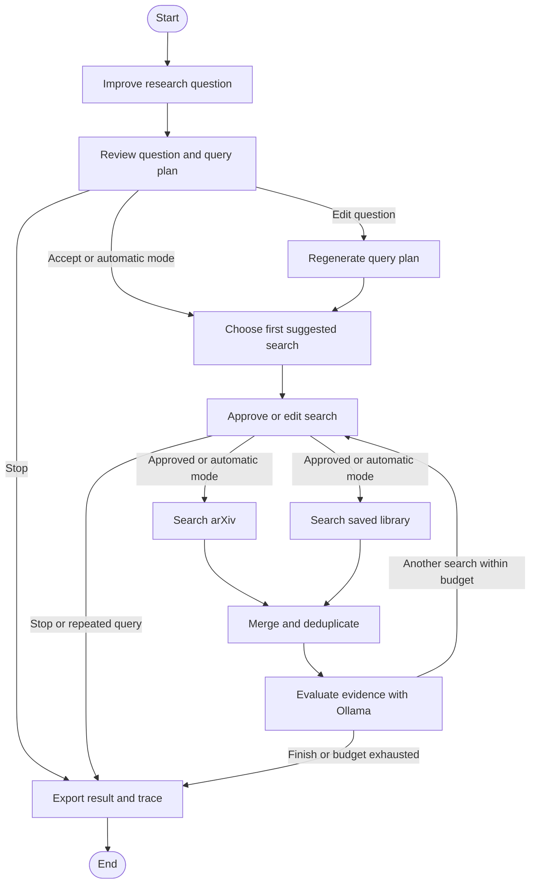

# Architecture and milestones

## Product goal

Help a researcher turn a natural-language query into a relevant, reviewable paper collection and an answer grounded in that collection. The researcher can refine the search plan and paper selection before synthesis.

## Proposed flow

```text
Research query + filters
          |
    Search planner
          |
   Human plan review <---- query refinement
          |
    Paper source adapters
          |
    Normalize + deduplicate + rank
          |
   Human paper selection
          |
    Abstract / permitted full-text ingestion
          |
    Chunking + embedding + retrieval
          |
    Answer synthesis + citations
```

## Component boundaries

| Component | Responsibility |
| --- | --- |
| Query planning | Turn the research question into search queries and explicit filters. |
| Source adapters | Search scholarly sources through a shared interface; preserve source identifiers and URLs. |
| Paper catalog | Normalize metadata and deduplicate by DOI, source ID, and title. |
| Ranking | Score relevance and present enough evidence for researcher selection. |
| Ingestion | Read abstracts and accessible full text while retaining paper and section provenance. |
| RAG | Retrieve relevant chunks and produce answers whose citations resolve to retrieved evidence. |
| Orchestration | Track workflow state, bounded retries, human decisions, and search iterations. |
| Evaluation | Measure retrieval quality, duplicate handling, and citation support on curated queries. |

## What works today

- `models.py` defines normalized paper metadata and search results.
- `planning.py` defines query refinements, decisions, search traces, and strict refinement validation.
- `sources/base.py` defines the source interface; `sources/arxiv.py` implements keyword/raw search, stable arXiv IDs, version deduplication, a 24-hour cache, and request pacing.
- `library.py` persists explicitly saved papers as Chroma documents. Ollama's `/api/embed` embeds each title and abstract. Metadata preserves the full paper record, save timestamp, and originating question. Stable IDs make repeated saves idempotent; saved snapshots retain their original provenance. A collection records its embedding model name and uses cosine similarity. Browse/remove operations do not need model inference.
- `ollama.py` uses separate structured-output prompts to improve the initial question and to evaluate retrieved evidence. Refinements contain a rewritten question, concepts, keyword alternatives, assumptions, and clarification questions. Subsequent decisions can request another search or finish with retrieved paper IDs.
- `agent.py` implements the workflow as a LangGraph `StateGraph`, with typed state, conditional edges, approval interrupts, and in-memory checkpoints. Each approved search fans out to separate arXiv and library nodes, which update separate state fields and join at `merge_results`. The merge deduplicates by stable ID, prefers fresh arXiv metadata on overlap, and preserves both retrieval origins. The shared evaluator can request another approved round or finish. These are two retrieval specialists governed by one planner/evaluator, rather than autonomous conversational agents. It enforces search limits, repeated-query detection, and paper-ID validation.
- The CLI exposes `search`, `refine`, `research`, and the local browser `ui`, with readable output and JSON exports. Direct search works without Ollama; standalone refinement does not call the paper source.

## LangGraph workflow



The first search uses the query-refinement node's first suggested keyword query. After retrieval, the evaluator considers the approved question, the query plan, search history, and paper excerpts to choose another query or finish. Alternative planned queries are suggestions, not a requirement to execute every variant.

State preserves the original question, the initial model rewrite, any researcher-edited question, the latest keyword plan, and actual source queries. Edits trigger a separate replanning node before retrieval. Checkpoint state contains ordinary records rather than custom serialized classes; the CLI reconstructs typed results at its boundary.

Human review and search approval use separate interrupting nodes. Model calls and network calls happen in other nodes, so approval resumption does not repeat those side effects. Each run gets its own thread ID. The current checkpointer is in memory and does not provide recovery after a process restart.

The graph permits at most five search rounds, with three by default. A round runs at most one arXiv request and one library search, each with the chosen candidate limit. It makes one initial refinement call, at most one extra call after a question edit, and one evaluation call after each round. For more than 20 accumulated candidates, additional bounded screening calls assess batches and retain up to five IDs per batch until the final context fits. The final evaluation is constrained to finish once the round budget is spent.

Library retrieval embeds the approved question plus the current approved search focus. Similarity retrieves candidates; the evaluator judges their relevance and can reject all of them. The two sources' ranking values are never compared numerically. Source failures are recorded in search steps, exposed to the evaluator and UI, and do not discard results from the other branch. If arXiv fails and neither the library nor earlier rounds supply any papers, the session reports an error.

The graph supplies the stopping explanation; model-generated assessments are exported separately. Open clarification questions remain explicit in the result until a new query-refinement plan changes them. The evaluator cannot clear them by asserting that retrieved papers answered the researcher's intent.

## Local browser interface

`ui.py` serves `static/` and a small JSON API from a loopback-only Python HTTP server. Each browser session owns a compiled research graph and an in-memory checkpoint thread. A background executor advances the graph until a query-review interrupt, a search-approval interrupt, or completion. Browser approvals resume it with `Command(resume=...)`.

- `GET /api/config` checks the local Ollama connection and lists installed models.
- `POST /api/sessions` starts query improvement with explicit round/result limits.
- `GET /api/sessions/{id}` returns progress, the pending review, papers, and results.
- `POST /api/sessions/{id}/respond` resumes the current review. A unique review ID prevents duplicate or stale approvals.
- `POST /api/sessions/{id}/cancel` stops at the next workflow boundary after the current operation.
- `GET /api/sessions/{id}/export` downloads the final result or current partial session as JSON.
- `POST /api/sessions/{id}/save` accepts an explicit list of retrieved paper IDs after research ends, or an empty list to skip. Embedding and persistence run in the executor; save progress/errors are separate from research status and can be retried. Unknown IDs and overlapping saves are rejected.
- `GET /api/library?limit=50&offset=0` pages through saved papers and their provenance.
- `POST /api/library/remove` removes a paper from the persistent collection, leaving existing session results intact.

The browser polls for progress and retains its session ID in tab-scoped storage for reloads. Questions, checkpoint state, and session history stay in server memory. The UI does not expose filesystem paths or allow browser requests to configure arbitrary model endpoints. Source queries still go to arXiv; model inference uses the configured Ollama server.

The first model provider is local Ollama and the first paper API is arXiv. Chroma uses a persistent local client at `data/library/`, with explicit embeddings supplied by Ollama (default `embeddinggemma`). There is one document per saved paper; PDFs and passage chunks are not ingested. The library persists independently of the graph checkpointer, so saved papers survive restarts while unfinished sessions do not. Source metadata and abstract excerpts inform search refinement; this is not yet a RAG answer-generation pipeline.

## First milestones

1. **Implemented — paper search:** one source adapter, keyword/raw query commands, normalized metadata, and JSON export.
2. **Implemented — LangGraph query improvement and assisted search:** structured question rewriting, concept extraction, keyword alternatives, explicit ambiguity, question review/replanning, per-search human approval, version deduplication, a model-selected shortlist, bounded graph transitions, and an action trace.
3. **Next — retrieval evaluation:** curate realistic questions, label relevant papers, and compare direct search with the agent's shortlist.
4. **Implemented — researcher paper selection and persistent library:** explicitly save chosen papers, browse/remove them, and retrieve semantic candidates alongside arXiv on later questions.
5. **Next — evidence retrieval:** ingest selected abstracts/full text, retain provenance, and retrieve relevant chunks.
6. **Next — grounded answers:** generate answers with resolvable citations and evaluate citation support.

## Data handling

- Store local papers, metadata, and indexes under `data/`; keep them out of Git.
- Keep secrets in environment variables or an untracked `.env` file.
- Store small synthetic test fixtures under `tests/fixtures/`.
- Preserve the origin of every paper and retrieved passage so users can inspect the supporting evidence.
